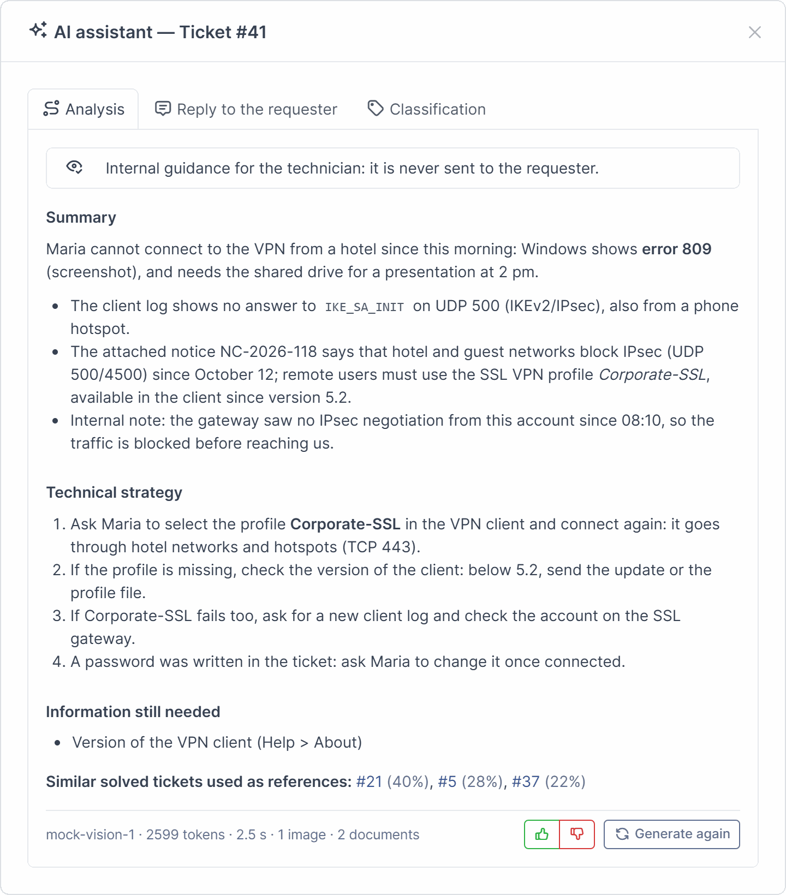
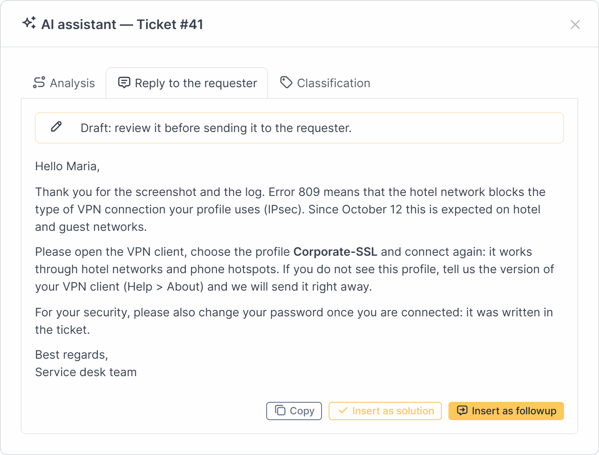
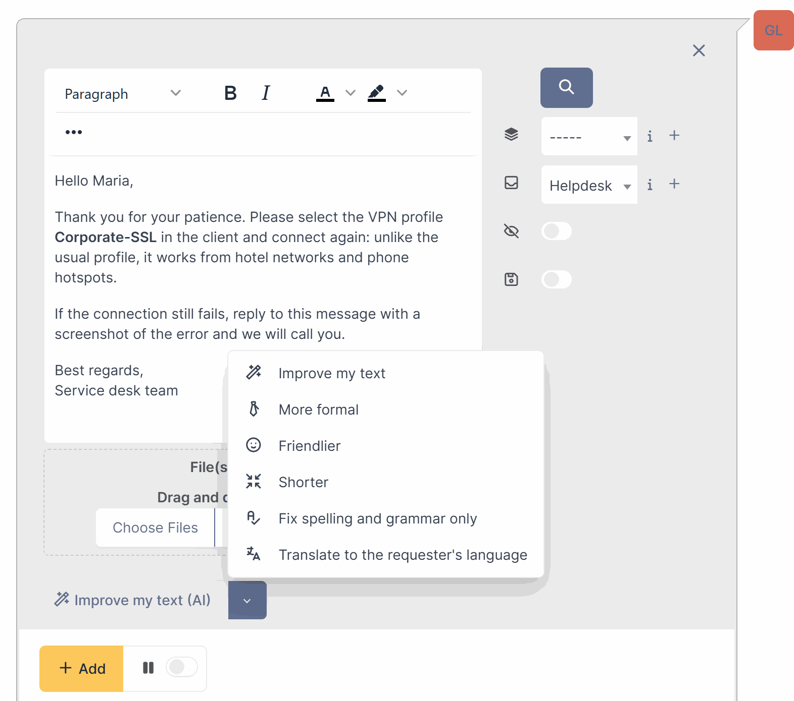
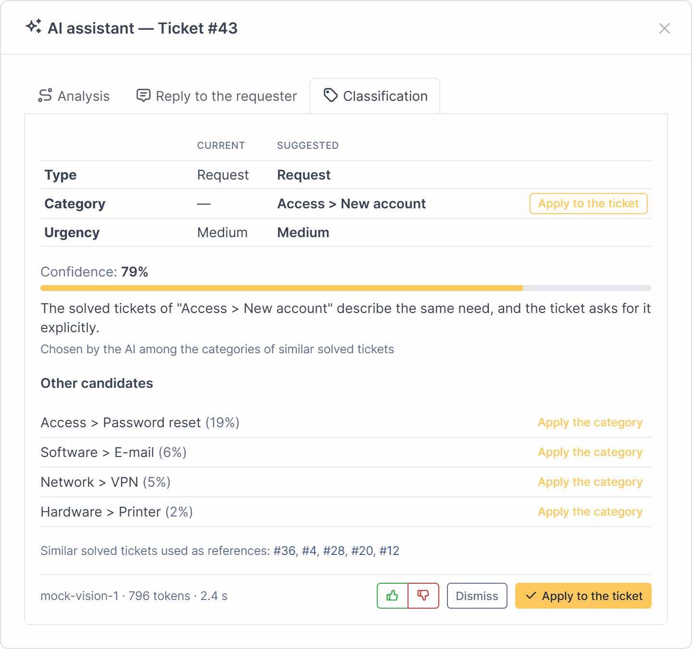
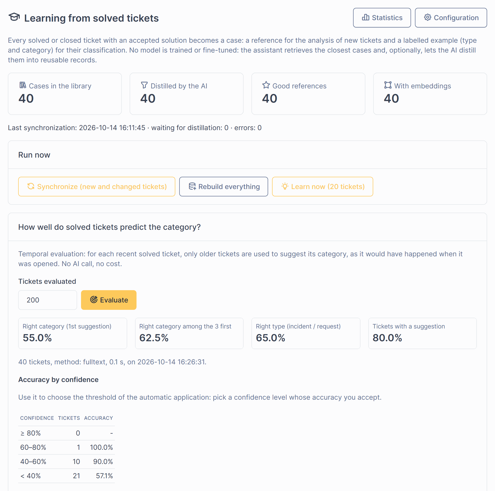
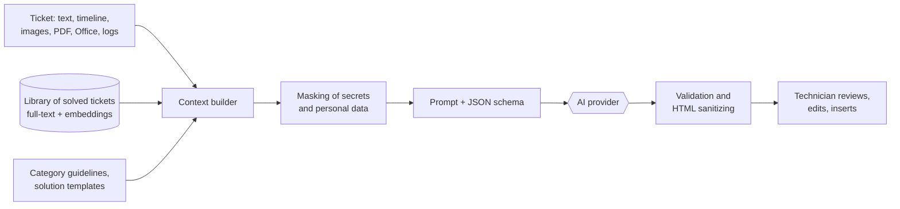

# GLPI AI Ticket Assistant

[](https://github.com/flpsantoro/glpi-ai-ticket-assistant/actions/workflows/ci.yml)
[](LICENSE)


**An AI assistant for GLPI technicians.** It reads the whole ticket — text, history, screenshots
and attached documents — and gives the technician a diagnosis, a step-by-step strategy and a reply
draft written in the team's standard. It rewrites drafts, suggests the type and category of tickets
by learning from the ones already solved, and turns solved tickets into knowledge base articles.

The technician stays in control: nothing is ever sent to the requester automatically.

*[Leia em português](README.pt-BR.md)*



## Highlights

- **Reads the whole ticket.** Description, followups, tasks, solutions (refused ones included),
  linked assets, approval status and the attachments of every item of the timeline: images
  (vision), PDF (digital or scanned), Word/Excel/PowerPoint/OpenDocument files, logs, CSV, JSON.
- **Two answers in one click.** Internal guidance for the technician (summary, probable cause,
  what to check, when to escalate, missing information) and a reply draft for the requester.
- **Improve my text.** Six modes in the followup and solution forms: improve, more formal,
  friendlier, shorter, fix spelling only, translate to the requester's language.
- **Learns from solved tickets, without fine-tuning.** Solved tickets become a searchable case
  library (full-text, optional embeddings, optional AI distillation). New tickets get the closest
  cases as references and a type/category/urgency suggestion; the accuracy is **measured** on your
  own history before you trust it.
- **Automatic triage** of new tickets (also those created by mail), with optional automatic
  application above a confidence threshold you choose from the measured accuracy.
- **Knowledge base articles** drafted from solved tickets, created unpublished for review.
- **Any provider.** OpenAI, Azure OpenAI, Anthropic, Google Gemini, Mistral, OpenRouter, Ollama
  and any OpenAI-compatible server (LM Studio, vLLM, LiteLLM…): cloud or 100 % local.
- **Governance built in.** Daily budgets, hourly limits per technician, audit log with cost per
  call, feedback 👍/👎, statistics, masking of secrets and personal data, private notes following
  the technician's rights, API keys encrypted with the GLPI key.
- **One code base for GLPI 10.0.11+, 11 and 12**, PHP 7.4 to 8.5, in English, Portuguese
  (Brazil), Spanish and French.

## Screenshots

| | |
|---|---|
|  |  |
| **Reply draft** — inserted in the followup or solution editor, never sent automatically. | **Improve my text** — six modes, the signature of the technician added by the server. |
|  |  |
| **Classification** — type, category and urgency from similar solved tickets, applied in one click. | **Learning** — library of solved tickets and accuracy measured on your history. |

Screenshots: GLPI 11 with the bundled demonstration data and the mock AI provider in scripted
mode (`tools/mock-llm/server.py --scripted`): the AI texts are written for the demonstration, not
generated.

## How it works



1. The **context builder** reads the ticket within a character budget (the oldest followups are
   left out first) and extracts text from documents; images go to vision models.
2. **References** come from the library of solved tickets: the most similar cases (full-text
   search, re-ranked by embeddings when enabled) with the solution the team applied.
3. **Masking** replaces secrets ("password: …"), payment cards, IBAN, CPF/CNPJ, e-mails, phone
   numbers or IP addresses, as configured, before anything leaves the server.
4. The answer must follow a **JSON schema**; its HTML is sanitized with an allowlist before
   being shown, and nothing is written in the ticket until the technician decides.

The "learning" is retrieval, not training: solved tickets are labelled examples. Classification
votes among the nearest cases (instant, free), then, optionally, the AI chooses among the candidate
categories with those cases as few-shot examples. The **Learning** page replays your history in
temporal order (each ticket classified only with older ones) and reports top-1/top-3 accuracy,
accuracy per category and per confidence level, frequent confusions and tickets that look
misclassified. Details in [docs/LEARNING-AND-CLASSIFICATION.md](docs/LEARNING-AND-CLASSIFICATION.md).

## Requirements

| | |
|---|---|
| GLPI | 10.0.11 or later, 11.0, 12.0 |
| PHP | the version required by your GLPI (7.4+ on GLPI 10), extensions `curl`, `mbstring`, `json` |
| Recommended | `gd` (downscales large images), `zip` (Office files), `poppler-utils` (complex and scanned PDFs) |
| AI | an account with a provider, or a local server (Ollama, LM Studio, vLLM…) |
| Automatic actions | GLPI cron in CLI mode (`php front/cron.php` every minute) |

Without poppler-utils a built-in reader extracts the text of digital PDFs; scanned PDFs then need
poppler-utils or a provider that reads PDF files natively (OpenAI, Anthropic).

## Installation

### With the installer (recommended)

The installer finds the GLPI installations of the machine and of its containers (Docker,
Podman), picks a compatible PHP and the web server user, copies the plugin, installs and enables
it, connects the AI provider (menu of providers, list of the models, connection test), builds the
library of solved tickets and checks the cron and the PDF tools. Arrow keys and Enter, in English
or Portuguese; it asks before changing anything.

**Linux**

```bash
git clone https://github.com/flpsantoro/glpi-ai-ticket-assistant.git
cd glpi-ai-ticket-assistant
sudo bash install.sh
```

**Windows** (XAMPP, WAMP, Laragon, IIS…), in PowerShell:

```powershell
git clone https://github.com/flpsantoro/glpi-ai-ticket-assistant.git
cd glpi-ai-ticket-assistant
powershell -ExecutionPolicy Bypass -File .\install.ps1
```

**GLPI in a container** (the official `glpi/glpi` image or any other): the same installers find
the running containers and install the plugin with `docker exec` and `docker cp`, on a volume when
there is one, without PHP on the host: `bash install.sh --docker glpi` or `.\install.ps1 -Docker glpi`
([details](docs/INSTALL.md#glpi-in-a-container)).

Run it again later to update the plugin, change the AI provider, test the connection or
uninstall. Unattended mode for automation: `sudo bash install.sh --help` or
`.\install.ps1 -Help`.

### Manually

1. Download `ticketassistant-x.y.z.tar.bz2` from the
   [releases](https://github.com/flpsantoro/glpi-ai-ticket-assistant/releases) and extract it in
   the `plugins/` directory of GLPI, so that the path is `plugins/ticketassistant/setup.php`.
2. In GLPI: **Setup > Plugins**, install then enable **GLPI AI Ticket Assistant**, or:
   ```bash
   php bin/console plugin:install --username=glpi ticketassistant
   php bin/console plugin:activate ticketassistant
   ```
3. Open **Setup > AI Ticket Assistant**, choose the provider, fill in the model and the key,
   **Save**, **Test the connection**, then **Enable the assistant** — or from the command line:
   ```bash
   printf '%s' "$OPENAI_API_KEY" | php bin/console plugins:ticketassistant:configure \
       --provider=openai --model=gpt-5-mini --api-key-stdin --enable --test
   ```
4. Technician profiles (those that can update tickets) receive the right **AI assistant** on the
   first installation; adjust it in **Administration > Profiles > AI assistant**.

The automatic actions (`aisync`, `ailearn`, `aitriage`, `aipurge`) run in CLI mode: make sure the
GLPI cron is configured. Full guide: [docs/INSTALL.md](docs/INSTALL.md).

### Try it without an API key

The repository ships a mock AI provider (Python standard library, no key, no cost), a Docker
environment and demonstration data (an entity, categories, 40 solved tickets and 3 open ones with a
screenshot, a PDF and a log file):

```bash
python tools/mock-llm/server.py --port 8099
docker compose -f tools/docker/docker-compose.yml --profile glpi11 up -d   # or glpi10, glpi12, all
```

When <http://localhost:8011> answers (the first start installs GLPI, login `glpi` / `glpi`):

```bash
alias glpi='docker compose -f tools/docker/docker-compose.yml exec -u www-data glpi11 php /var/www/glpi/bin/console'
glpi plugin:install --username=glpi ticketassistant && glpi plugin:activate ticketassistant
glpi plugins:ticketassistant:configure --provider=compatible --base-url=http://host.docker.internal:8099/v1 --model=mock-vision-1 --enable --test
glpi plugins:ticketassistant:demo --yes
glpi plugins:ticketassistant:sync
```

See [docs/DEVELOPMENT.md](docs/DEVELOPMENT.md).

## Providers

| Provider | Vision | PDF files | Embeddings | Notes |
|---|---|---|---|---|
| OpenAI | yes | yes | yes | reasoning and standard models, strict JSON schema |
| Azure OpenAI | yes | — | yes | deployments (`api-version`) or the v1 API |
| Anthropic (Claude) | yes | yes | — | use a second connection for embeddings |
| Google Gemini | yes | — | yes | OpenAI-compatible endpoint |
| Mistral AI | yes (Pixtral) | — | yes | |
| OpenRouter | depends on the model | — | — | one key, many models |
| Ollama | yes (vision models) | — | yes | local, no key, no cost |
| Other OpenAI-compatible API | depends | — | depends | LM Studio, vLLM, LiteLLM, Groq, DeepSeek… |

Model names are free text (a button lists the models of the provider). Configuration, prices and
proxies: [docs/PROVIDERS.md](docs/PROVIDERS.md).

## Privacy and security

- Only what is needed is sent: masked text, attachments within the limits you set, the requester's
  first name (optional). Private followups and tasks follow the rights of the technician.
- API keys are encrypted with the key of the GLPI installation and never displayed again.
- Outbound calls are restricted to http(s), cloud metadata addresses are refused, redirects are
  not followed; an allowlist can be enforced with the `TICKETASSISTANT_URL_ALLOWLIST` constant.
- Every call is logged with tokens, cost, duration and model; generated texts can be kept for
  audit with a retention period.
- Ticket content is wrapped as data in the prompt, and the AI output is validated and
  sanitized before display.

Read [docs/SECURITY-AND-PRIVACY.md](docs/SECURITY-AND-PRIVACY.md) before sending real tickets to a
cloud provider, and check the terms of your provider about data retention and training.

## Documentation

| Guide | Contents |
|---|---|
| [User guide](docs/USER-GUIDE.md) | for technicians: analysis, reply, improve, classification, articles |
| [Installation](docs/INSTALL.md) | requirements, install, upgrade, cron, uninstall, troubleshooting |
| [Configuration](docs/CONFIGURATION.md) | every setting, with its default |
| [Providers](docs/PROVIDERS.md) | OpenAI, Azure, Anthropic, Gemini, Mistral, OpenRouter, Ollama, compatible APIs |
| [Learning and classification](docs/LEARNING-AND-CLASSIFICATION.md) | case library, embeddings, triage, evaluation |
| [Security and privacy](docs/SECURITY-AND-PRIVACY.md) | data flow, masking, rights, hardening |
| [Operations](docs/OPERATIONS.md) | automatic actions, commands, budgets, statistics, errors |
| [Development](docs/DEVELOPMENT.md) | architecture, GLPI 10/11/12 compatibility, tests, translations |

Portuguese: [instalação](docs/pt-BR/INSTALACAO.md), [configuração](docs/pt-BR/CONFIGURACAO.md)
and [guia do usuário](docs/pt-BR/GUIA-DO-USUARIO.md).

## FAQ

**Is this the official "GLPI AI" plugin?** No. GLPI AI is the commercial plugin of Teclib' for
GLPI Network subscribers. This is an independent, community plugin under the GPL.

**Does it train a model on my tickets?** No. Solved tickets are searched and used as examples in
the prompt; nothing is fine-tuned. Whether the provider keeps or uses the data depends on its terms.

**Can it run without any cloud service?** Yes, with Ollama or any OpenAI-compatible local server.

**Will it answer the requester by itself?** No. Every text is a draft inserted in the editor.
Only the classification can be applied automatically, and only if you enable it.

## Contributing

Issues and pull requests are welcome, in English or Portuguese. See
[CONTRIBUTING.md](CONTRIBUTING.md) and the [changelog](CHANGELOG.md). Security problems: please
follow [SECURITY.md](SECURITY.md).

## License

[GPL-2.0-or-later](LICENSE), like GLPI. © 2026 Felipe Santoro Alcantara.

GLPI is a registered trademark of Teclib'. This project is not affiliated with or endorsed by
Teclib'. Other product names belong to their owners.
