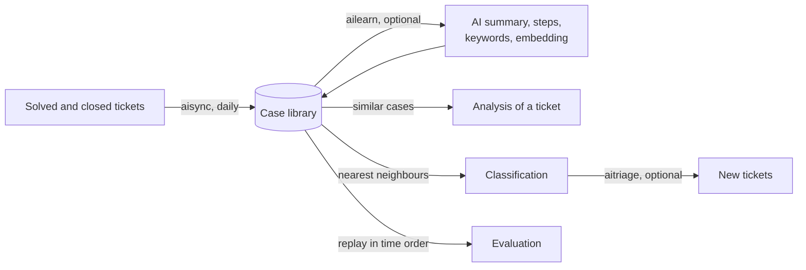

# Learning from solved tickets and classification

The assistant "learns" from the tickets your team already solved **without training a model**:
solved tickets are searched and given to the AI as references and labelled examples. This is how
most service desk products do it, it works from the first day, it is cheap, it follows changes of
the category tree immediately, and its accuracy can be **measured on your own history** before you
rely on it.



## The case library

Every solved or closed ticket that has a solution (the last one not refused) becomes a case:

- **problem**: title and description; **solution**: the accepted solution;
- **labels**: type (incident or request), ITIL category, entity, solve date;
- masked with the privacy detectors of the configuration, plus the "secrets" detector, always;
- a content hash: an unchanged ticket is not processed again.

The automatic action `aisync` updates it every day (tickets changed since the last run), removes
the cases of reopened or deleted tickets, and marks changed ones for a new distillation. The
**Learning from solved tickets** page (Setup > AI Ticket Assistant) shows the library and has
buttons to synchronize now or rebuild everything; from the command line:

```bash
php bin/console plugins:ticketassistant:sync          # recent changes
php bin/console plugins:ticketassistant:sync --full   # every ticket again
```

### Search

Cases are found with the MySQL/MariaDB **full-text index** (no extra service: problem, solution, AI
summary and keywords), then ranked by the **similarity of their words**, from 0 to 1: the cosine of
the meaningful words of the ticket and of the case, common words of English, Portuguese, Spanish and
French, accents and plurals left aside ("Wi-Fi" and "wifi" are the same word). The full-text
relevance of MySQL alone is not used: on a small library it is dominated by common words. The cases
of the same category get a small boost, the technician only receives cases of the entities they can
see (**Only use solved tickets of the entities of the technician**), and references less similar
than **Minimum similarity of a reference** (0.10 by default) are not sent.

### Semantic search (optional)

With **Enable semantic search** and an embeddings model, each case gets an embedding (float32
vector stored in the database, no vector database needed). A search then compares the ticket with
the full-text candidates **and** with the most recent cases (**Recent tickets scanned**, 3000 by
default), so tickets written with different words still match ("cannot print" / "printer outputs
blank pages"). The minimum similarity then applies to the cosine of the embeddings, which is higher
for the same texts: raise it to 0.3–0.5, depending on the model.

### AI distillation (optional)

With **Distill solved tickets into reusable, anonymized records**, the automatic action `ailearn`
asks the AI, for each new case, for:

- a generic summary of the problem and the reusable resolution steps, without personal data;
- keywords that improve the full-text search;
- the type and category the AI would choose;
- whether the case is **reusable** (a one-off, an unfinished or an unclear solution is not sent as a
  reference).

The distilled summary replaces the raw text in the references. Cases where the category chosen by
the AI differs from the real one are listed on the Learning page: they often reveal tickets
classified by mistake, or categories that overlap. Distillation and embeddings stop for the day when
the **Daily budget of automatic actions** is reached.

```bash
php bin/console plugins:ticketassistant:learn --limit=200   # distill now, within the budget
```

## Classification

**Classification** (tab of the assistant, or the suggestion shown on new tickets) suggests the
type, the ITIL category and the urgency:

1. **Vote of the nearest neighbours**: the `classify_neighbors` most similar cases (25 by default)
   vote for their category and type, weighted by similarity (with embeddings, the closest cases
   count much more). Instant, free, no AI call. The confidence is the share of the vote of the
   category, reduced when fewer than 5 cases voted or when even the closest case is a weak match
   (similarity below 0.3).
2. **Choice by the AI** (optional, on by default): the AI reads the ticket and chooses among the
   allowed categories (those of the entity of the ticket, compatible with the type), with the
   similar cases and their real categories as examples. The confidence combines the AI's confidence
   and the vote.

The categories offered are always those GLPI allows for the ticket: entity, recursion and the
"incident"/"request" flags of each category. **Apply to the ticket** updates the ticket with the
rights of the technician; every suggestion is recorded with what happened to it (applied,
dismissed, applied automatically), which gives the acceptance rate on the Statistics page and, once
the tickets are solved, the real accuracy.

## Automatic triage

With **Suggest a classification when a ticket is created**, new tickets (from the form, the mail
collector, the API…) are queued; the automatic action `aitriage` (every 5 minutes) computes their
suggestion. Technicians see a **Suggested category (xx %)** button on the ticket.

**Apply automatically above the threshold** writes the category and type directly when the
confidence reaches **Confidence threshold**. Enable it only after looking at the evaluation:
choose a threshold whose measured accuracy you accept (see below). Automatic triage can use the
AI (`triage_use_llm`) within the budget of automatic actions; without it, it uses the free vote.

## Evaluation

The Learning page (or `php bin/console plugins:ticketassistant:evaluate`) replays your history:
each recent solved ticket is classified **using only the tickets solved before it**, as it would have
been when it was opened. No AI call, no cost. It reports:

| Measure | Meaning |
|---|---|
| Right category (1st suggestion) | top-1 accuracy |
| Right category among the 3 first | top-3 accuracy (what a technician sees in the list) |
| Right type | incident / request |
| Tickets with a suggestion | coverage (tickets with at least one similar case) |
| Accuracy by confidence | for each confidence level, how often the suggestion was right: **use it to choose the automatic threshold** |
| Per category | recall of each category: low values point to vague or overlapping categories |
| Most frequent confusions | pairs of categories often mistaken for one another |
| Probably misclassified | solved tickets whose neighbours strongly agree on another category |

```bash
php bin/console plugins:ticketassistant:evaluate --sample=500
php bin/console plugins:ticketassistant:evaluate --sample=500 --embeddings
```

What to expect: the accuracy depends on the history (number of solved tickets per category, how
consistently they were classified) more than on the model. Merging overlapping categories, adding a
short description to each category (sent to the AI) and fixing the misclassified tickets listed by
the evaluation usually help more than changing the model.

## AI guidelines per category

In **Setup > Dropdowns > ITIL categories**, the tab **AI assistant** of a category holds
instructions added to the prompt for its tickets: what to ask for, which procedure or team applies,
when to escalate. They can be inherited by the sub-categories (the most general first).

## Knowledge base articles

On a solved or closed ticket, the tab **Knowledge base** writes an article (symptoms, cause,
solution steps) from the ticket and its solution; **Create a draft article** creates it
**unpublished** and linked to the ticket, so that it is reviewed and given an audience in the
knowledge base before anyone sees it.
